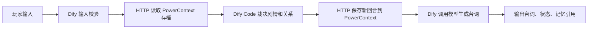

# 记仇杂货铺：老板还记得你上次干的好事

一个有跨会话记忆的 NPC 小游戏。老板阿栗嘴硬心软：你把招牌改成“咸鱼收容所”，换一个会话回来，他仍会把柜台挪远半米。送礼、道歉能修复关系，最终解锁隐藏菜单。

**交付状态：代码、两份 DSL、运行说明和验收脚本齐全；真实 PowerContext 读写和进程重启验证已通过。当前机器没有运行 Dify，也没有配置模型服务，尚未完成 Dify 实际导入、节点执行及真实 AI 台词验证，不能据此宣称已通过赛事基础验收。** 最后一步按第 4、5 节配置后运行验收脚本，补齐 Dify 运行证据即可提交复核。

全部作品资产位于本目录；基于比赛要求的 `2026-competition-ecosystem` 分支开发。原始题目保留在 `dify.md`。

## 1. 玩法及技术分工

目标：与老板混熟，拿到“隐藏菜单”徽章。每局最多 20 回合，初始硬币 3、记仇 0、信任 0。玩家编号是独立存档标识，跨会话保持相同编号即可续玩，使用新编号可恢复初始条件，无需删除任何数据库。

| 行动 | 规则与反馈 |
| --- | --- |
| 打招呼 | 没有恶作剧历史时信任 +1；有旧账时具体提及往事，关系不变 |
| 恶作剧 | 记仇 +2、信任 -1；保存具体恶作剧，累计两次获得“本街显眼包” |
| 送礼 | 消耗 1 硬币，记仇 -1、信任 +2；没有硬币时不改变关系 |
| 道歉 | 记仇 -1、信任 +1，不消耗硬币 |
| 打听传闻 | 信任至少 3 且没有记仇时，透露隐藏商品；否则给出熟客线索 |

记仇范围 0–5、信任范围 -3–5；曾恶作剧且累计修复至少两次、记仇归零，获得“和好如初”；第 4 回合起，信任至少 3 且记仇归零，获得“隐藏菜单”。AI 只负责演出，状态与徽章由规则确定。



- **Dify**：输入处理、HTTP 编排、Code 节点中的关系裁决与剧情分支、模型请求、错误回退、结果输出。不是用 Dify 包装一个完成全部玩法的后端。
- **PowerContext 1.4.1**：唯一的持久游戏记忆来源。每位玩家对应稳定 Scope；通过 `/v1/memory/remember` 写入完整回合快照，通过 `/v1/atomic-memory/list` 读取并复用最新状态。真实返回的 ArtifactRef 随结果输出。未使用自行仿造的 PowerContext API。
- **桥接服务**：将玩家编号映射至 Scope，读取、保存记忆，校验规则，处理重试和并发冲突。没有自建游戏状态数据库；重启后从 PowerContext 恢复。
- 本作品选用 **Dify + PowerContext**，不依赖 seekdb。PowerContext 自身使用官方支持的 SQLite 持久化配置，符合题目“至少一种”的选型。

## 2. 文件与版本

| 文件 | 用途 |
| --- | --- |
| `dsl/grudge-shop-ai.yml` | 正式 AI 工作流；直接使用 HTTP 调用兼容 Chat Completions 的模型服务 |
| `dsl/grudge-shop-rules.yml` | 无模型的规则验收工作流，用来排查记忆、网络和规则链路 |
| `game.py`、`server.py` | 规则源码、PowerContext 桥接源码 |
| `tools/run_local.py` | 启动真实 PowerContext 与桥接服务 |
| `tools/verify.py` | 六回合验收，支持本地链路或真正的 Dify Workflow API |
| `tools/check_persistence.py` | 自动启动、写入、停止、重启并核对存档和引用 |
| `tools/check_dsl.py`、`tests/` | DSL 引用与语法检查、关键规则边界及回退测试 |
| `tools/check_contracts.py` | 可选的 Dify 官方节点数据类及 Compose 配置预检，不替代真实导入 |
| `tools/build_dsl.py` | 从源码重新生成两份自包含 DSL，无需运行时导入外部代码 |
| `deploy/compose.override.yaml`、`tools/prepare_dify.py` | Dify 1.9.1 的宿主机网络配置与部署准备 |
| `evidence/` | 实际运行证据、明确的验证范围 |

目标 Dify：**官方 1.9.1 自部署版，DSL 0.4.0**。本次环境：Windows、Python **3.12.8**、PowerContext **1.4.1**、PyYAML **6.0.3**。无需自定义插件、知识库、Embedding 或 Rerank 模型。Dify 其他版本尚未验证。PowerContext 的 Windows 支持为 experimental，本次实测上述接口正常。

`requirements.txt` 固定主要依赖，`requirements-lock-windows.txt` 保存这次 Windows 完整安装版本。Windows 严格复现用 lock 文件；Linux 用主要依赖清单重新解析平台依赖，Linux 环境尚未实测。模型可选择已有的兼容 Chat Completions 的中文聊天模型，具体模型名称、服务版本及运行记录须在最终 Dify 验收时填入 `evidence/README.md`。

## 3. 先启动并体验真实记忆（Windows PowerShell）

在仓库的 `dify` 目录执行。Python 3.12、Git 需已安装；安装依赖需要网络。依赖下载量约百 MB，运行无需下载预置数据。

```powershell
python -m venv .venv
.venv\Scripts\python.exe -m pip install -r requirements-lock-windows.txt
.venv\Scripts\python.exe tools\run_local.py
```

保持窗口运行。在第二个终端、同一目录执行：

```powershell
.venv\Scripts\python.exe tools\play.py --player judge01
.venv\Scripts\python.exe tools\verify.py
.venv\Scripts\python.exe -m unittest discover -s tests -v
.venv\Scripts\python.exe tools\check_dsl.py
.venv\Scripts\python.exe tools\check_persistence.py
```

`play.py` 是命令行规则体验入口；Dify 发布后的网页才是正式应用入口。本地验证器执行 DSL 中原样提取的 Code 节点并调用真实 HTTP 服务，**不模拟或声称启动了 Dify 引擎**。报告包含 `dify_runtime_verified: false`。

默认服务为 `http://127.0.0.1:8000`（PowerContext）及 `http://127.0.0.1:8765/docs`（桥接接口文档）。桥接密钥自动生成于 `.runtime/shop-key.txt`，不在控制台日志中输出。数据、日志和密钥均位于被 Git 忽略的 `.runtime/`。正常按 Ctrl+C 停止；也可在另一终端执行：

```powershell
.venv\Scripts\python.exe tools\run_local.py --stop
```

只有本次启动的服务会被停止。再次运行会保留存档。端口冲突时启动器直接报错，不复用已有服务。持久化测试使用独立数据目录和 18000、18765 两个端口。

Linux/macOS 用 `python3 -m venv .venv`、`.venv/bin/python -m pip install -r requirements.txt`，后续将命令中的 Python 路径换为 `.venv/bin/python`。

## 4. 从零准备 Dify 并导入 DSL

### 4.1 Dify 部署

启动 Docker Desktop，启用 Linux 容器；预留足够空间拉取 Dify、数据库及配套镜像。建议给 Docker 分配 4 核、8 GB 内存；此资源配置尚未在本机实测。全部命令仍从本作品的 `dify` 目录执行：

```powershell
git clone --depth 1 --branch 1.9.1 https://github.com/langgenius/dify.git .runtime/dify-upstream
.venv\Scripts\python.exe tools\prepare_dify.py .runtime/dify-upstream
docker compose --project-directory .runtime/dify-upstream/docker --env-file .runtime/dify-upstream/docker/.env -f .runtime/dify-upstream/docker/docker-compose.yaml -f deploy/compose.override.yaml up -d
```

部署采用官方 `langgenius/dify-api:1.9.1`、`langgenius/dify-web:1.9.1` 及该版本原配的数据库、Redis、sandbox、代理等服务，应用使用的记忆独立位于 PowerContext。脚本会从官方 `.env.example` 生成本地配置、生成本地密码并将页面端口设为 8080，不启动 Docker，不覆盖已有 `.env`。

浏览器打开 `http://localhost:8080/install` 创建本地管理员，再进入工作室。首次部署无比赛专用账号或外部云服务要求。

Docker 中的 Dify 需要访问宿主机桥接服务。停止第 3 节启动器，然后改用：

```powershell
.venv\Scripts\python.exe tools\run_local.py --host 0.0.0.0
```

`SHOP_URL` 使用 `http://host.docker.internal:8765`。提供的 compose 覆盖文件为 Linux Docker 增加 host-gateway 解析；Desktop 也能使用此主机名。PowerContext 仍只监听本机 8000，只有需要密钥的桥接服务开放给 Dify。宿主机防火墙需允许 Docker 网络访问 8765。Dify Cloud 不能访问你的宿主机地址；本说明以自部署为准。

Dify HTTP 节点通过其 SSRF 代理出站。准备脚本在官方 Squid 模板的 `http_access deny all` 之前加入对 `host.docker.internal` 的定向允许规则，没有全局关闭代理。若模型服务是公网域名，在首次准备时加 `--model-host 你的模型域名`；若之后才配置，则在同一模板的 deny 之前补充：

```text
acl shop_model dstdomain 你的模型域名
http_access allow localnet shop_model
```

修改代理后用同一 compose 参数执行 `restart ssrf_proxy`。HTTPS 模型服务优先使用 443 端口。自定义 HTTPS 端口还需要在 Squid 的 `SSL_ports` 中允许该端口。

### 4.2 导入顺序与配置

1. 工作室 → 创建应用 → 导入 DSL 文件，先导入 `dsl/grudge-shop-rules.yml`。
2. 打开工作流的环境变量配置，将 `SHOP_URL` 设为上述地址，`SHOP_API_KEY` 设为 `.runtime/shop-key.txt` 中的内容（secret 类型）。
3. 点运行，以 `player_id=judge-dify-01`、`action=恶作剧`、`line=把招牌改成咸鱼收容所` 体验；规则版不需要模型。
4. 再导入 `dsl/grudge-shop-ai.yml`，为新应用设置同样的两个变量，以及下表中的模型变量。两份 DSL 相互独立，无知识库或工具需要重新绑定。
5. 发布 AI 工作流，使用“运行应用”打开其 Dify 网页入口；从“访问 API”创建此工作流的 API Key 供第 5 节验证使用。

| AI 环境变量 | 填写内容 |
| --- | --- |
| `LLM_URL` | 模型服务的完整聊天接口地址，形如 `https://你的服务/v1/chat/completions`，不是只填域名 |
| `LLM_MODEL` | 该服务实际支持的模型标识；不预设用户已有任何模型 |
| `LLM_API_KEY` | 服务提供方的密钥，保留 secret 类型；本地无鉴权服务可留空 |

模型请求为 `model/messages/temperature/max_tokens/stream:false` JSON，读取 `choices[0].message.content`。不用安装 Dify 模型插件，也不用把密钥填进 DSL 或玩家输入。模型服务在用户自有服务商或本地推理服务获取，其调用费用依所选服务而定。修改规则后需重新运行 `tools/build_dsl.py` 并重新导入 DSL。

AI 版默认模型 URL 指向桥接服务的一个不存在路径，未配置时会显示“模型不可用，已回退到规则版”。这便于先验证存档链路，**不能把该输出当成真实模型调用证据**。网络超时、非成功状态或返回结构不符也会回退，状态与存档保留。读取或保存 PowerContext 失败时直接终止回合，不伪造成功。

## 5. 完整验收样例

用一个从未使用过的玩家编号；同一编号按顺序运行，每回合换新的 `request_id`，留空则使用 `sys.workflow_run_id`。每次重新打开应用入口或用不同 Dify API user，排除 Dify 会话历史的影响。

| 步骤 | 行动 / 台词 | 预期表现 |
| --- | --- | --- |
| 1 | 恶作剧 / 把招牌改成“咸鱼收容所” | 回合 1，记仇 2、信任 -1、硬币 3；输出 PowerContext 记忆引用 |
| 2 | 打招呼 / 留空 | 新会话仍提及咸鱼招牌；回合 2，记仇仍为 2 |
| 3 | 道歉 / 我错了 | 回合 3，记仇 1、信任 0 |
| 4 | 送礼 | 回合 4，记仇 0、信任 2、硬币 2，获得“和好如初” |
| 5 | 送礼 | 回合 5，记仇 0、信任 4、硬币 1，获得“隐藏菜单” |
| 6 | 打听传闻 | 回合 6，透露后悔药味汽水，保留所有状态 |

AI 台词没有唯一答案；必须回应当前行动、提及已保存的具体旧事，符合记仇/和解状态。状态面板是确定的验收依据。正文会显式注明 AI 台词还是规则回退。

在第 2 步之后，重放第 1 步完全相同的请求编号、行动和台词，应该返回第 1 步的相同状态，注明重复请求，不新增回合、不回滚当前存档。换编号 `judge-dify-other` 打招呼，应该是独立初始状态，不提及其他玩家的旧事。

发布后可自动执行完整样例（将地址替换成 Dify 页面展示的 Service API 地址）：

```powershell
$env:DIFY_API_KEY = '替换为已发布工作流的API密钥'
.venv\Scripts\python.exe tools\verify.py --dify-url http://localhost:8080/v1 --output evidence/local-dify-verification.json
Remove-Item Env:DIFY_API_KEY
```

脚本每次生成全新玩家编号，每回合更换 API user；成功报告应包含 `dify_runtime_verified: true`。AI 版还应有 `live_model_verified: true`；否则检查模型配置和回退提示。报告不记录鉴权头。将报告审核后以不带 `local-` 前缀的名字加入提交，并补充 Dify 工作流运行详情截图、模型服务/模型版本。规则版和 AI 版各自发布时会有不同的应用 API Key。

已交付实际记录见 `evidence/README.md`。验收不依赖作者现存数据库、账号或本地玩家存档，所有数据均由上述操作生成。

需要独立交付压缩包时，执行 `python tools/package.py`，生成 `dist/grudge-shop.zip`。打包采用文件白名单，包含源码、DSL、说明、实际证据和 SHA-256 清单，排除虚拟环境、运行数据、本地密钥及 `local-` 验证日志。

## 6. 运行边界和排错

- 桥接只运行 **单 worker、单实例**，在该进程内对 prepare/commit 做并发冲突校验。相同玩家并行提交，过期回合返回 409，重新运行即可；不可用多副本部署替代此配置。
- 请求编号用于幂等；同编号配不同输入返回 409。模型失败时已确认的游戏回合仍已保存，重试需保留原请求编号。达到 20 回合后换玩家编号开始新局。
- 玩家编号是存档选择器，桥接密钥保护整个体验环境。本作品定位为可信评审/个人环境，未实现公开多用户账号授权，不应将这个共享密钥和存档接口直接交给公开访客。
- 503：先检查 PowerContext 的 `/health/ready` 和 `.runtime/powercontext.log`。没有生成/Embedding 模型的提示不影响本作品使用的显式记忆 API。
- Dify HTTP 节点连不上桥接：确认以 `--host 0.0.0.0` 启动、环境变量使用宿主机地址、代理允许该域名、宿主机防火墙开放 8765。`127.0.0.1` 在容器内指容器自身。
- Code 节点失败：确认 Dify sandbox 健康，查看节点错误；规则代码只使用 Python 标准库，不需要 sandbox 安装额外包。
- 凭据仅放本地 `.env`、`.runtime/` 和 Dify secret 环境变量；示例不包含真实凭据。停止官方 Dify 时，使用相同 compose 参数执行 `down`，不要添加 `-v`，以保留数据。

## 7. 来源

玩法、规则、桥接服务与 DSL 为本作品编写，没有复制公开示例作品的剧情或工作流。使用的第三方组件与接口来自：

- [PowerContext 1.4.1 源码](https://github.com/oceanbase/powercontext/tree/powercontext-v1.4.1)（Apache-2.0），[官方 HTTP 快速开始](https://powercontext.oceanbase.io/zh/docs/develop/api-quickstart/)。固定版本接口以包内实现和该标签 `openapi/powercontext.yaml` 为准。
- [Dify 1.9.1 官方部署文件](https://github.com/langgenius/dify/tree/1.9.1/docker)（Dify Open Source License），本作品仅提供外部部署覆盖和配置准备脚本，不重新分发其镜像或源码。
- [Dify HTTP Request 文档](https://docs.dify.ai/en/cloud/use-dify/nodes/http-request)及[应用导入导出说明](https://docs.dify.ai/en/cloud/use-dify/workspace/app-management)。
