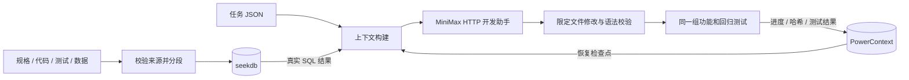

# 规有所依 · 一页技术说明

**目标**：让开发助手在局部修改时拿到适用规格、真实代码、功能与回归测试，以及上一次工作的进展。验证载体为工单查询的归档可见性修改。

**索引与选择**：`project.json` 显式列出资料类型和符号关系。规格按 `## R-NNN` 标题分块，代码和测试按文件保存，每块记录路径、行区间、正文、哈希。完整新代次先写入 `sdd_documents`，单条指针写入发布 `sdd_imports`。上下文 SQL 从当前代次选择适用规格编号，并按符号关系或字面关键词召回代码、测试和数据。必要来源缺失即报错；不是用固定文本拼装答案。

**变更处理**：来源文件与 manifest 共同生成 SHA-256 指纹。上下文构造前重新核对本地文件与活动索引；变更未导入时拒绝返回旧上下文。重导入后只查询新代次，来源行号和正文随内容更新。历史代次保留供审计，暂未实现清理。

**状态复用**：项目、任务与 namespace 映射为 PowerContext 的幂等 Scope。使用 `/v1/memory/remember` 写入带 revision 的完整检查点；使用 `/v1/atomic-memory/list` 分页恢复，不使用本地 JSON 充当状态源。保存事项、待办、测试结果、日志哈希和工程指纹；重启后根据状态决定继续工作还是审阅既有验证。完整测试日志另存于证据目录，检查点不超过官方接口的 8192 字节限制。规格或代码变化时，历史验证仍可读，但标为过期。每任务单写入者。

**技术分工**：seekdb 实际存储并查询工程资料；PowerContext 保存并复用任务进度；MiniMax 接收上述检索上下文，返回允许文件的完整修改。默认本地服务由 Python 官方 `pylibseekdb 1.4.0.post2` 与 PowerContext 1.4.1 启动，Node 的 seekdb SDK 1.4.0 通过 TCP SQL 查询。MiniMax 通过 Anthropic 兼容 HTTP 接口接入，限制修改范围并记录公开开发过程，不保存凭据或私有思考内容。

**验证与边界**：同一 8 项功能测试修改前 7 项业务失败、修改后全部通过；9 项回归在前后均通过。自动验收还覆盖必要来源、规格更新、真实查询、从空状态写入及两个服务与 CLI 重启后的复用。当前未提供 MiniMax 密钥，已交付修改为参考实现，真实 MiniMax 参与仍待补齐。检索采用显式关系与字面匹配，不声称具备语义推理或完整 Agent 会话恢复。
